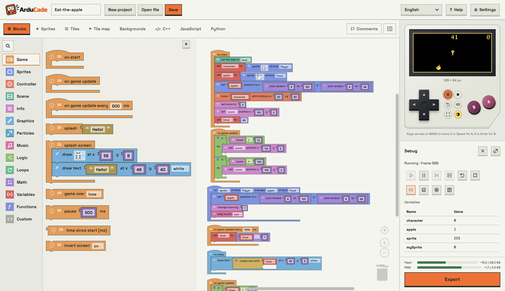

<picture>
  <source media="(prefers-color-scheme: dark)" srcset="press/logo_dark.svg">
  <source media="(prefers-color-scheme: light)" srcset="press/logo.svg">
  
</picture>

# ArduCade

Create games for Arduboy and DIY handheld consoles in your browser. Build with
blocks or write JavaScript or Python, play immediately in the simulator, then
compile for supported AVR devices or export an Arduino IDE sketch. Games use a
128 × 64, one-bit display.



## Features

* **Block editor:** Blockly game blocks for sprites, collisions, tile maps,
  camera, score, lives, particle effects and music.
* **Instant simulator:** play with keyboard or on-screen D-pad and A/B buttons,
  including simultaneous touch presses on tablets.
* **Debugger:** pause, step through blocks or frames, set breakpoints, inspect
  variables and sprites, and read the game log.
* **Pixel art tools:** sprite animation, tile, tile map and background editors,
  with a built-in sprite and tile library.
* **Sound and music:** sound effects, melodies written with note letters, and
  six ready made songs with four voices (melody, harmony, bass and drums)
  played by [ATMlib](https://github.com/JKirchartz/ATMlib). See
  [Songs](docs/songs.md).
* **Game templates:** Platformer, Pong, Space shooter, 3D ghost hunt (ray casting
  built from blocks), Brick breaker, Flying bird, Match three and Frog crossing
  (Frogger-style).
* **Guided learning:** step-by-step game projects with chapters, progress checks,
  hints, solutions and playable previews.
* **Text coding:** editable JavaScript and Python with syntax highlighting,
  engine API completion and error markers. Text games use the same simulator
  and compile to C++ for the device. These are game-oriented language subsets;
  see [JavaScript and Python](docs/text-languages.md) for syntax and limitations.
* **C++ view:** inspect generated device code and highlight the code for the
  selected block.
* **Device export:** compile supported AVR targets in the browser using
  WebAssembly avr-gcc, download HEX files and upload over USB with Web Serial.
  Memory meters show estimates while editing and compiled flash/static RAM sizes
  after a build.
* **Hardware profiles:** select a development board or configure chip, clock,
  display, bus, buttons and sound, then save or share the profile.
* **Five languages:** English, Norwegian Bokmål, Spanish, French and German.
* **Static site:** the editor, simulator and compiler run in the browser.
  Projects are saved locally in browser storage and can be downloaded as files.

## Getting started

1. Open ArduCade and choose a game template, an empty project or a guided project.
2. Edit the blocks and artwork, then play in the simulator.
3. Use **Save → Download game** to keep a portable copy of your project.
4. Select your hardware profile and use **Export** to compile/upload or download
   an Arduino IDE sketch, depending on the target.

For local setup, see [Development](#development). The editor's **Help** includes
block documentation, hardware profiles, wiring and console build guides.

## Saving and sharing games

**Save → Download game** exports a PNG game cartridge containing the full
project, including artwork and any JavaScript/Python source. Reopen it with
**Open file**, or share the original PNG so others can edit and play the game.
Older `.abproject` (JSON) files can still be imported and used as templates.

Choose the automatic game thumbnail or play and capture a frame in the compact
simulator opened from the save dialog. Use the on-screen screenshot button or
press B on the keyboard to capture the current frame. The simulator supports
touch D-pad and A/B buttons, including simultaneous presses.

Keep the original downloaded PNG: editing or re-encoding it in an image tool
may remove the embedded project. Download a copy to keep a backup outside your
browser's local storage.

## Supported hardware

| Chip | Boards | Compile in browser | Upload in browser |
|---|---|---|---|
| ATmega32U4 | Arduboy, DevKit, Leonardo, Micro, Pro Micro (16 MHz) | yes | yes (AVR109) |
| ATmega328P | Nano, Uno, Pro Mini | yes | yes (STK500, Optiboot and old bootloader) |
| ATmega328PB | Nano clones, MiniCore | yes | yes |
| ATmega644P | MightyCore | yes | yes |
| ATmega1284P | MightyCore | sketch download | no |
| ATmega2560 | Mega 2560 | sketch download | no |
| ATmega4809 | Nano Every | sketch download | no |
| LGT8F328P | LGT Nano clones | sketch download | no |
| RP2040, ESP32, ESP8266, SAMD21, STM32F103 | Pico, DevKit, D1 mini, Zero, Blue Pill | sketch download | no |

"Sketch download" gives a folder for the Arduino IDE with the game, the
engine and `ab_config.h` for the chosen profile. Install the board package and libraries
listed in the exported README, then compile and upload with the Arduino IDE.

Browser compilation depends on the selected board, core and clock as well as
the chip. ATmega32U4 profiles at 8 MHz and Adafruit ItsyBitsy profiles use Arduino
IDE export. See [Hardware profile configuration](docs/hardware-profile-boards.md)
for board choices and restrictions.

Screens: SSD1306, SH1106 and SSD1309, over I2C or SPI.

An optional **ATtiny85 Pico** profile is available through the extra settings:
hold **Settings** for five seconds with a mouse or finger, or focus it and hold
Space, then enable the profile. It compiles in the browser and exports HEX for
an external ISP programmer; browser upload is unavailable. This target has
8 KB flash, 512 bytes RAM, an SSD1306 I2C display and two buttons (Left + Right
also produce A). See **Help → Build an ATtiny85 console** in the editor.

ESPboy Original, Kit and a DIY preset with direct backlight are available in
hardware profiles. Games remain black and white at 128x64, centered without
scaling on the 128x128 ST7735 screen. Copy a preset to edit ESP8266 GPIO,
MCP23017 button/CS pins, I2C and SPI wiring, expander address and optional
MCP4725 backlight control. The simulator runs the same game logic at 128x64.
ESPboy exports an Arduino IDE sketch; browser compilation/upload is unavailable.
The exported README lists the ESP8266 board package and Adafruit ST7735 library
setup. Memory meters are rough game-only estimates, excluding the ESP8266 core,
display libraries, heap and stack; Arduino IDE reports actual build sizes.
See [ESPboy support](docs/espboy.md) for wiring and limitations.

## Development

Use Node.js 22.12 or newer and npm.

```sh
npm install
npm run dev        # editor at http://localhost:5173
npm test           # generators, simulator, compiler and translations
npm run build      # static site in dist/
```

`npm run gen` (part of `dev` and `build`) writes the font header, the
template files in `public/templates`, and copies the WebAssembly compiler to
`public/compiler/tools` and Blockly media to `public/blockly-media` from
`node_modules`.

### Layout

```
core/ardublocks/     C++ engine and display drivers that run on the device
src/hw/              chips, hardware profiles, pin checks, ab_config.h
src/ir/              intermediate representation and type checking
src/blocks/          block definitions, toolbox, blocks to IR
src/gen/             IR to C++ and IR to simulator JavaScript
src/text/            JavaScript/Python parsers and editable source generation
src/sim/             simulator engine (a port of core/ardublocks/ardublocks.h)
src/compile/         in-browser compiler (Web Worker)
src/upload/          Web Serial upload: STK500v1 and AVR109
src/templates/       templates, written with a small helper language
src/guides/          guided projects, course steps and progress checks
src/project/         project storage, PNG cartridges, assets and sketch export
src/ui/              the editor
public/locales/      one JSON file per language
public/compiler/     compiler files (sysroot is committed, tools are copied)
scripts/             generators and build helpers
press/               logos and editor screenshot for the GitHub README
```

The simulator engine in `src/sim/engine.ts` must behave exactly like
`core/ardublocks/ardublocks.h`. Change both together.

### Adding languages, templates and profiles

* **Language:** add `public/locales/<code>.json` (copy `en.json`) and add the
  language to `LANGUAGES` in `src/i18n/i18n.ts`. `npm run check-locales`
  lists missing texts.
* **Template:** download a game from the editor (**Save → Download game**), put
  the `.png` file in `templates/` on the server and add its name to `templates/index.json`.
* **Hardware profile:** save a profile from the editor, put the `.abprofile`
  file in `profiles/` and add its name to `profiles/index.json`. A link like
  `https://example.com/arducade/?profile=profiles/my-nano.abprofile` loads
  it directly.

### Rebuilding the compiler files

`public/compiler/sysroot` holds the Arduino core, avr-libc headers and
libraries for each chip the browser compiles for. It is made with a native
avr-gcc 7.3.0:

```
node scripts/fetch-cores.mjs
npm test                      # writes .cache/gen/*.ino used to find headers
AVR_GCC_DIR=/path/to/avr-gcc node scripts/build-sysroot.mjs
```

## Documentation

* [JavaScript and Python](docs/text-languages.md): supported syntax and examples.
* [Hardware profile configuration](docs/hardware-profile-boards.md): boards,
  clocks and profile format.
* [ESPboy support](docs/espboy.md): wiring, export setup and limitations.
* [Songs](docs/songs.md): the ATMlib song player, hardware support and how to
  add a song.
* [Project specification](docs/spec.md) (Norwegian): design and technical background.

## Publishing on a web server

See [docs/deploy-one-com.nb.md](docs/deploy-one-com.nb.md) (Norwegian) for a
step-by-step guide for one.com:

1. `npm run build`
2. Upload everything in `dist/` (including `.htaccess`) to the web server.
3. Make sure the site uses HTTPS. Web Serial does not work without it.

## Licenses

The ArduCade code does not have a license file yet. The WebAssembly compiler in
`public/compiler/tools` comes from
[@horang-corp/avr-gcc-wasm](https://www.npmjs.com/package/@horang-corp/avr-gcc-wasm)
and is GCC and GNU binutils (GPL v3). The sysroot contains avr-libc (BSD
style license), libgcc (GPL with the GCC runtime exception) and the Arduino
AVR core (LGPL). See `public/compiler/tools/THIRD_PARTY_NOTICES.md`.

The song player in `core/ardublocks/ab_atm.h` and `src/sim/atm.ts` is based on
[ATMlib](https://github.com/JKirchartz/ATMlib) by TEAM a.r.g., Davey Taylor
and Joeri Gantois (BSD 3-Clause License). The license text is in
`core/ardublocks/ab_atm.h`, which is included in every exported sketch.
