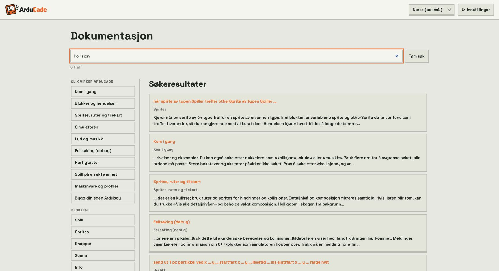

# Søk i dokumentasjonen

Søkefeltet øverst i dokumentasjonen søker i alle synlige veiledninger, blokkbeskrivelser, bildetekster og eksempler. Det finnes både på dokumentasjonssiden og i dokumentasjonsdialogen fra editoren.

Skriv for eksempel **kollisjon** for å finne hendelsen som kjører når to sprites treffer hverandre. **Kule** finner prosjektilblokkene, og **musikk** finner lydveiledningen. Søket bruker tekst og egne nøkkelord, så ordet trenger ikke stå i den synlige beskrivelsen. Treff på titler prioriteres først, deretter nøkkelord og til slutt beskrivelsene.



Flere ord avgrenser søket: hvert ord må finnes i treffets tittel, kategori, tekst eller nøkkelord. Store og små bokstaver og aksenter behandles likt. Velg et treff for å åpne seksjonen eller den aktuelle blokken. **Tilbake til treff** viser resultatene igjen. **Tøm søk** fjerner søket og viser seksjonen du åpnet sist. Alle kontrollene kan brukes med berøring, mus og tastatur.

## Legge til nøkkelord

Felles synonymer vedlikeholdes i `DOCS_KEYWORDS` i `src/ui/docs-search.ts`. Nøkkelen er seksjonens id, for eksempel `assets`, eller blokktypen, for eksempel `ab_on_overlap`. Verdien er ord og uttrykk som skal gi treff.

Språkspesifikke nøkkelord kan legges til i `ui` i `public/locales/<språk>.json`, uten å endre den synlige dokumentasjonsteksten:

```json
"docs.keywords.ab_on_overlap": "kollisjon krasj berøring treffe",
"docs.keywords.assets": "grafikk tegning animasjon bakgrunn"
```

Seksjoner og blokker indekseres automatisk fra dokumentasjonen. Nøkkelord er et tillegg til teksten. Bare tilgjengelige seksjoner tas med; den skjulte ATtiny-veiledningen søkes først når den er aktivert.

Illustrasjonene i `public/docs/` er ikke endret. Skjermbildet over ligger i `docs/images/`.
