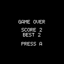

# ESPboy in ArduCade

ESPboy support retains the project's original 128×64 one-bit graphics, six game
buttons and existing game engine. It introduces no color blocks, larger game
resolution or additional game buttons. The 128×64 image is centered vertically
on the physical 128×128 screen, with black margins and no scaling. Rotation and
mirroring apply to the game image. The browser simulator remains unchanged.

## Hardware profiles

The screen selector identifies the physical panel as **ESPboy ST7735 (128×128
TFT)**. This is the standard 1.44-inch screen listed in the official ESPboy
breadboard bill of materials. The adapter initializes that panel and converts
ArduCade's one-bit buffer to black/white TFT pixels; game and simulator resolution
remain 128×64. The Arduino library's name also mentions ST7789, but this adapter
uses ST7735; that library name is not a claim of support for other panel types.

Choose ESPboy Original or ESPboy Kit, or the DIY preset when the backlight is
wired directly rather than controlled by an MCP4725 DAC. These presets share
the standard ESPboy wiring. DIY is a starting point for compatible builds,
not a claim that every homemade device uses these pins.

Copy a profile, or edit it to create a custom copy, to change the wiring.
Profiles can be saved, exported and imported like other ArduCade devices.

| Function | Default |
|---|---|
| Display | ST7735, 128×128, 1.44-inch green-tab initialization (TFT_eSPI GREENTAB3 reference setup) |
| Display MOSI / clock | GPIO13 / GPIO14 |
| Display DC / reset | GPIO16 / tied to board reset (no GPIO) |
| Display CS | MCP8 |
| I2C SDA / SCL | GPIO4 / GPIO5 |
| MCP23017 address | 0x20 |
| Left / up / down / right | MCP0 / MCP1 / MCP2 / MCP3 |
| A / B | MCP4 / MCP5 |
| Speaker | GPIO0 |
| Optional MCP4725 backlight address | 0x60 |

MCP0–MCP15 refer to the expander, not ESP8266 GPIO numbers. Buttons and display
CS can use MCP pins or GPIO. DC, reset and sound use GPIO. Bus pins and I2C
addresses are editable; invalid or conflicting assignments prevent export.
Default SPI wiring uses hardware SPI; custom SPI pins use software SPI. Software
SPI is slower. Reusing hardware MISO/GPIO12 or SS/GPIO15 also selects software SPI.
The display CS is held low, so additional modules sharing its SPI bus are not
supported. ESPboy's two extra buttons and RGB LED are outside this integration.
The brightness slider controls the optional DAC; it has no effect on a directly
wired backlight. GPIO0/2/15 are ESP8266 boot-strapping pins: custom wiring must
preserve the board's boot levels.

## Build and upload

1. Select an ESPboy profile and download the Arduino sketch from ArduCade.
2. Install the ESP8266 Arduino board package using its official Boards Manager
   URL: https://arduino.esp8266.com/stable/package_esp8266com_index.json.
3. Select **LOLIN(WEMOS) D1 R2 & mini**, matching the standard ESPboy board.
4. Follow the exported `README.txt` for the selected display backend:
   - **Standard SPI wiring:** install **TFT_eSPI 2.5.43**. Back up its
     `User_Setup.h` and replace the contents with the exported
     `ESPboy_User_Setup.h`. In `User_Setup_Select.h`, only the
     `#include <User_Setup.h>` setup should be selected. A setup beside the
     sketch alone does not configure the separately compiled library. Repeat
     this step after library updates or changes to display DC/reset pins.
   - **Custom SPI wiring or GPIO12/GPIO15 conflicts:** the export automatically
     selects **Adafruit ST7735 and ST7789 Library 1.11.0** and software SPI.
     Install its dependencies (tested: GFX 1.12.6 and BusIO 1.17.4). No TFT_eSPI
     configuration is needed for this backend.
5. For TFT_eSPI, run its **Read_User_Setup** example and save the serial output.
   The generated setup uses ST7735, 128×128, GREENTAB3, BGR, 27 MHz SPI,
   MOSI GPIO13, SCK GPIO14, profile DC/reset, CS -1 and MISO -1. The adapter
   rejects missing or incompatible configuration at compile time.
6. Open the exported `.ino`, compile and upload in Arduino IDE. Select 80 MHz.

The export includes the game, engine, ESPboy adapter, generated `ab_config.h`,
setup README, adapted ESPboyMCP helper and, for TFT_eSPI, the generated setup.
Original/Kit use the official standard wiring by default; copy a preset to
change I2C pins, addresses, buttons, DC/reset, sound or backlight. Standard
MOSI/SCK with no GPIO12/GPIO15 conflicts retains TFT_eSPI even with other custom
wiring. Other SPI arrangements select software SPI automatically.

The implementation follows the maintainer's **FirstTest ESPboyLibs TFTeSPI**
example at commit `fbd4393d46d47242315ab373d24e0aa72e1764db`. The included
`ab_espboy_mcp.h` derives from RomanS's `ESPboyMCP.h/.cpp`: combined header-only,
configurable I2C pins/addresses, optional DAC and safe failed reads. One
`readGPIOAB()` call captures both expander ports for simultaneous button presses.
The adapter uses the reference's MCP and TFT APIs, rather than the full
`ESPboyInit::begin()`, which fixes hardware pins and includes a logo, startup
animation/delay and DAC EEPROM write. We initialize only the selected hardware,
write brightness without touching EEPROM, and keep the existing Arduino tone
engine on the profile's speaker GPIO. Wi-Fi is disabled at startup.

The browser's AVR compiler does not compile ESP8266 firmware. Flash and RAM
meters are approximate game-only figures, excluding platform/display libraries,
heap and stack. They do not predict final ESP8266 binary size or guarantee fit.
Actual static memory sizes come from the Arduino IDE build report; runtime heap
and stack consumption additionally depend on execution. Flash capacity in the
profile is chip capacity; partitioning reduces space available to firmware.

## Official references

- [ESPboy website and compatible variants](https://www.espboy.com/)
- [ESPboy Arduboy2 port and hardware initialization](https://github.com/ESPboy-edu/ESPboy_Arduboy2_lib/tree/master/src/lib)
- [Reference FirstTest example](https://github.com/ESPboy-edu/ESPboy_FirstTest/tree/fbd4393d46d47242315ab373d24e0aa72e1764db/ESPboy_FirstTest_ESPboyLibs_TFTeSPI)
- [Official TFT configuration](https://github.com/ESPboy-edu/ESPboy_ArduinoIDE_Libraries/blob/master/TFT_eSPI-master/User_Setup.h)
- [Adafruit ST7735 library](https://github.com/adafruit/Adafruit-ST7735-Library)

## Sound holds on the game over screen

If a tone continues while **GAME OVER / PRESS A** is displayed, export the
Arduino sketch again from the current ArduCade version. Replace the entire
sketch folder, including `ardublocks.h`, then compile and upload the new `.bin`.
Updating only the `.ino` leaves the old engine in use. The engine must continue
updating sound effects while it waits for A; otherwise an effect's current tone
can keep playing indefinitely.

For example, in Platformer, walk into the enemy on the right until all three
lives are gone. The descending game over effect should finish and leave the
speaker silent while this screen remains visible. Press A (X in the emulator)
to start again.

The [ESPboy emulator](https://joyrider3774.xyz/espboy_emulator/ESPboy_Emulator.html)
can test the actual compiled `.bin` through **Open file…**. Its source is
available at [joyrider3774/espboy_emulator](https://github.com/joyrider3774/espboy_emulator).
On 2026-10-13, the supplied Platformer binary reproduced a sustained 392 Hz
tone. Its compiled game over wait loops read buttons and delay without updating
sound. A fresh build using the current engine completed the effect and became
silent in the same emulator scenario. Physical ESPboy validation is still
needed.

## Hardware test handoff

No physical ESPboy was available during implementation. Compile success does
not validate panel offsets, brightness, sound or physical input behavior.
Every exported README includes this handoff checklist:

1. On a standard ESPboy, run the upstream FirstTest example to confirm the hardware.
2. Upload an ArduCade game. Check the complete 128×64 image, black/white pixels
   and 32 black rows above and below, with no clipping or stray edge pixels.
3. Test all six buttons, held inputs and simultaneous direction + A/B presses.
4. Check sound and, with MCP4725, brightness at low/middle/high settings.
5. Restart and play for several minutes to check freezes or watchdog resets.
6. Export rotation/mirroring variants and check orientation. For custom hardware,
   compare each wire, bus address and reset connection with `ab_config.h`.

Report the board model, game, exported profile, ESP8266 core and library versions,
TFT setup diagnostic output, compile flash/RAM report and pass/fail observations.
A video or photo of display problems helps identify panel initialization issues.

Validation: automated tests cover standard/custom export selection, setup values,
profile round trips and unchanged simulator/game generation. Actual ESP8266
builds use core 3.1.2, TFT_eSPI 2.5.43, Adafruit ST7735 1.11.0, GFX 1.12.6
and BusIO 1.17.4. Physical hardware verification is pending.
