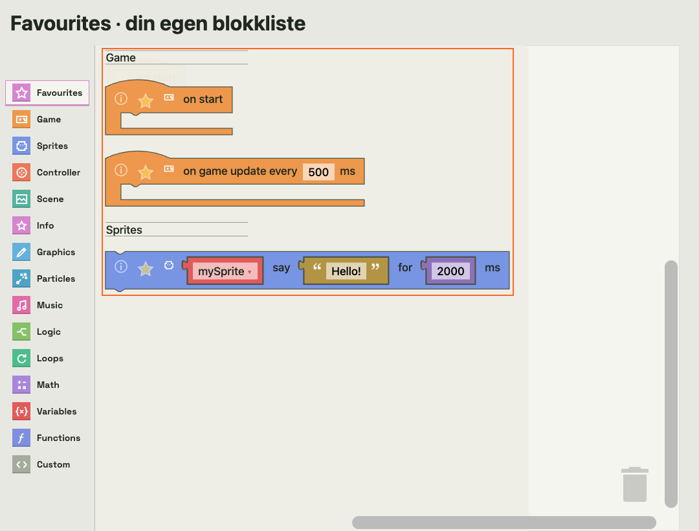

# Favorittblokker

Trykk på den lille stjernen med omriss på en blokk i menyen. Stjernen blir fylt,
og blokken legges til i **Favourites**, øverst i kategorilisten. Trykk igjen for å
fjerne favoritten. Dette virker også i søkeresultater, med mus og berøring.
Med tastatur kan du fokusere stjernen og trykke Enter eller mellomrom.

Favorittene grupperes i samme kategori- og blokkrekkefølge som den vanlige
menyen. Hver gruppe har kategorinavnet mellom to linjer. Rekkefølgen du
stjernemerker i, påvirker ikke rekkefølgen i listen. Ulike varianter av samme
blokk kan velges hver for seg og beholder standardverdiene sine.

Prøv dette:

1. Åpne **Sprites** og stjernemerk blokken som lar en sprite si noe i en bestemt tid.
2. Åpne **Game** og stjernemerk «ved start».
3. Åpne **Favourites**. Game vises først, deretter Sprites.
4. Dra blokkene inn i editoren og sett dem sammen som vanlig.

Stjerner vises bare på menyblokkene. Blokker som er dratt inn i editoren,
får ingen stjerner. Å velge en favoritt endrer ikke spillkoden.

Listen hører til prosjektet og lagres automatisk sammen med det. Både
`.abproject`-filer og eksporterte PNG-cartridges inkluderer favorittene.
Åpne cartridgen igjen for å fortsette med den samme listen. Eldre prosjekter
åpnes med en tom favorittliste. Prosjektformat 3 legger til `favouriteBlocks`,
med kategori og blokkens oppskrift; eldre versjoner oppgraderes ved åpning.
