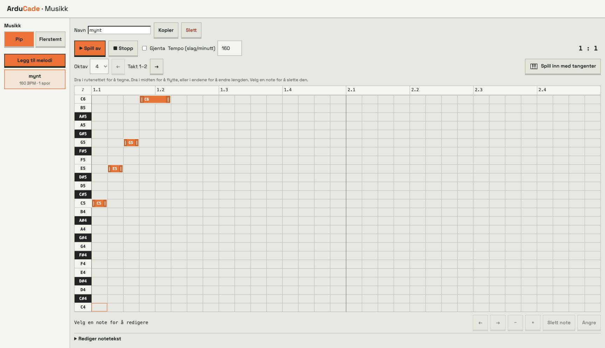
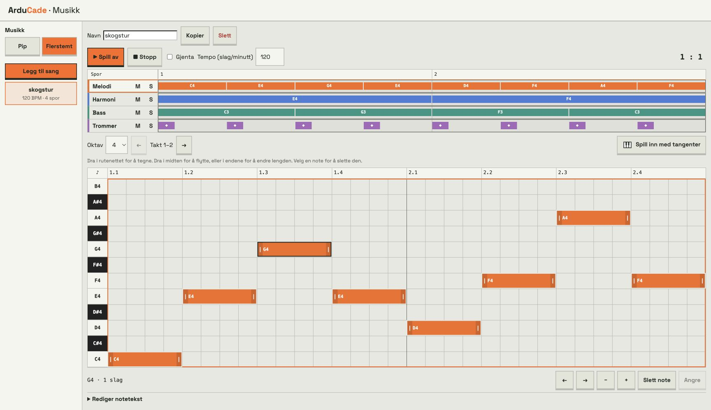
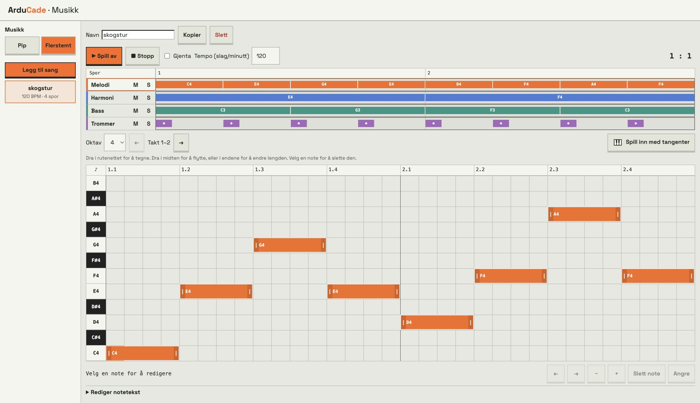
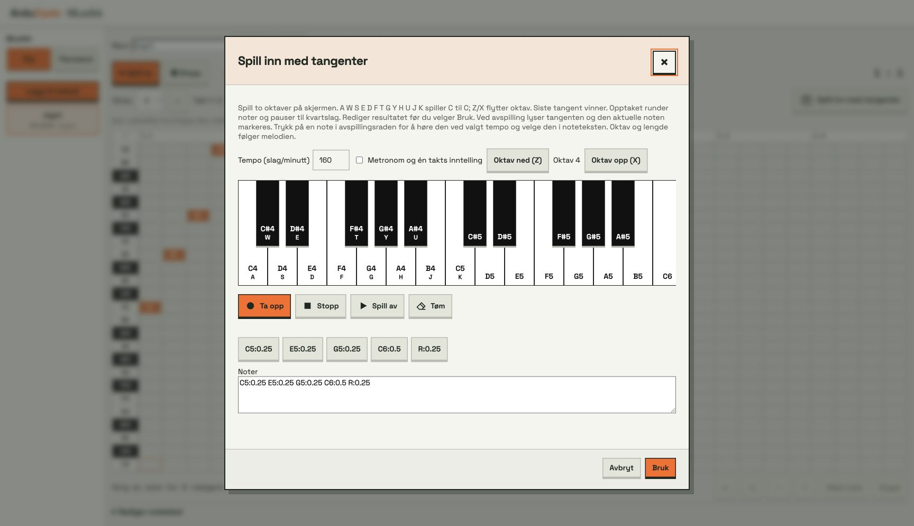

# Musikk i ArduCade: fra første note til fire spor

Denne veiledningen finnes også under **Hjelp → Lyd og musikk**. Den viser arbeidsflyter for både nybegynnere og viderekomne. Skjermbildene bruker norsk språk og fargetemaet. Åpne [eksempelprosjektet](../public/examples/music-guide.abproject) med **Åpne fil** i appen. **A** spiller mynt, **B** spiller skjold, pauser bakgrunnssangen og lar den fortsette automatisk.

## Velg hvordan du vil lage musikk

Åpne Musikk-fanen. Pip er en melodi med én stemme: én note om gangen, som en klassisk spillkonsoll. Flerstemt er en sang med fire spor som kan spille samtidig: melodi, harmoni, bass og trommer. Melodier og sanger lagres hver for seg i prosjektet.

Begynn med Pip og en kort myntlyd. Velg Flerstemt når du vil lage bakgrunnsmusikk eller en lyd med flere lag. Pip-blokker har én note og rosa farge; flerstemte blokker har to noter og en mer lilla farge i fargetemaet. Alle finnes i samme Lyd-kategori. Skjermbildene viser norsk språk og fargetemaet.

## Lag din første bip-melodi

Velg Pip → Legg til melodi og kall melodien mynt. Sett tempoet til 160. Åpne Rediger notetekst, og skriv eksemplet under. Trykk Spill av. Du skal høre fire stigende toner og en kort pause.

Du kan også tegne notene i rutenettet. Tiden går fra venstre mot høyre; høyere rader gir lysere toner. Hver liten rute er et kvart slag. En note som er fire ruter lang varer ett slag. Takt 1–2 viser åtte slag i 4/4. Oktav-velgeren endrer toneområdet du ser, ikke tonehøyden på notene som allerede finnes.

Navn, noter og tempo oppdateres i prosjektet når du redigerer. Bruk Lagre øverst i appen for å lagre prosjektfilen. Kopier lager en egen variant; Slett fjerner hele melodien etter bekreftelse.



```text
C5:0.25 E5:0.25 G5:0.25 C6:0.5 R:0.25
```

Melodien er 1.5 slag lang: 0.25 + 0.25 + 0.25 + 0.5 + 0.25. Ved 160 BPM er det omtrent 0.56 sekunder. Pausen er med i lengden.

## Tegn, flytt og endre notelengde



Trykk på et tomt sted, hold nede og dra mot høyre for å tegne en note. Slipp for å lagre den. Ta tak i midten av noten og dra til venstre eller høyre for å flytte starttidspunktet. Dra venstre eller høyre ende for å gjøre noten kortere eller lengre. Lengdene følger kvartslagsrutene.

Velg en note og bruk Slett note, Backspace eller Delete. Med mus kan du også høyreklikke og velge sletting. På nettbrett bruker du de synlige knappene: ← og → flytter ett kvart slag, − og + endrer lengden ett kvart slag. Angre reverserer siste rutenettendring i denne redigeringsvisningen.

Å dra midten flytter noten i tid, ikke opp eller ned i tonehøyde. For en annen tone, slett og tegn på riktig rad, eller rediger noteteksten. Hvert spor spiller én note om gangen. En ny, flyttet eller forlenget note erstatter hele noter den overlapper, også når bare en del av den gamle noten overlapper; bruk Angre hvis resultatet ble feil. Pilene ved Takt bytter mellom sider på to takter.

Når rutenettet har fokus, flytter piltastene markøren. Enter eller mellomrom lager en note på ett slag eller velger en eksisterende note på stedet. Med en valgt note flytter ←/→ den i tid; Shift + ←/→ endrer lengden. Ctrl/Cmd + Z angrer og Escape avbryter draget eller valget. Skjermknappene er alternativer for berøring.

## Lag en sang med fire spor

Velg Flerstemt → Legg til sang, og kall sangen skogstur. Sett tempoet til 120. Velg ett spor om gangen og skriv den tilhørende linjen under i Rediger notetekst. Alle linjene er åtte slag lange: to takter. Trykk Spill av for å høre dem sammen.

Melodi er en pulsbølge, Harmoni en firkantbølge, Bass en trekantbølge og Trommer støy. De fire fargene viser hvilket spor notene tilhører. Oversikten øverst viser hele arrangementet. Trykk på en note der for å gå til riktig spor, oktav og takt; rutenettet under redigerer bare det valgte sporet.

M demper et spor under forhåndslytting; S lar deg høre sporet alene. Dette er lyttehjelp i editoren, og lagres ikke som demping i spillet. Hvert spor er monofonisk. For en akkord må tonene fordeles mellom Melodi, Harmoni og Bass. Trommesporet gir støyslag, ikke forskjellige trommeinstrumenter ut fra notenavnet.



**Melodi**

```text
C4:1 E4:1 G4:1 E4:1 D4:1 F4:1 A4:1 F4:1
```

**Harmoni**

```text
E4:4 F4:4
```

**Bass**

```text
C3:2 G3:2 F3:2 C3:2
```

**Trommer**

```text
C4:0.25 R:0.75 C4:0.25 R:0.75 C4:0.25 R:0.75 C4:0.25 R:0.75 C4:0.25 R:0.75 C4:0.25 R:0.75 C4:0.25 R:0.75 C4:0.25 R:0.75
```

Ved 120 BPM varer åtte slag fire sekunder. De to taktene skifter fra C-durklang (C–E–G) til F-klang (F–A–C). Harmoniens E blir stående over første takt som en utvidelse av C-klangen; du kan bytte den til G4:4 for å sammenligne. For tydeligere F-durharmoni i andre takt, prøv A4:4 i Harmoni i stedet for F4:4.

## Spill inn med tangenter

Trykk Spill inn med tangenter. Du får to oktaver med skjermtangenter. Spill ved å trykke og holde tangenter med mus eller finger. Med tastatur spiller A W S E D F T G Y H U J K fra C til neste C; Z/X flytter oktaven. Oktav ned/opp gir samme funksjon på skjermen.

Velg tempo først. Metronom og én takts inntelling gir fire slag før opptaket starter. Ta opp starter et nytt opptak og tømmer notefeltet i dialogen. Stopp avslutter. Tiden du holder en tangent blir notelengden; tiden uten tangent blir pauser. Noter og pauser rundes til nærmeste kvart slag. Sist trykkede tangent vinner: opptaket er én stemme, også når du åpner det fra en flerstemt sang.

Spill av for å kontrollere opptaket. Tangenten lyser og den aktuelle noteknappen markeres. Noteknappene er synlige også når lyden er stoppet og legger seg på nye linjer. Trykk på en noteknapp for å stoppe løpende avspilling, høre akkurat den noten med riktig oktav og lengde og velge den i teksten. Rediger før du velger Bruk. Bruk erstatter notene i valgt melodi eller spor og overfører tempoet; Avbryt eller lukk beholder originalen. Et nytt tempo gjelder hele sangen.



## Notetekst: nøyaktig styring

C D E F G A B er notene; H betyr også B. # hever en halvtone, og liten b senker en halvtone: F#4 og Bb4. Et tall uten kolon er oktaven: C5 ligger én oktav over C4. :2 betyr to slag, :1/2 et halvt slag og :0.25 et kvart slag. R eller - er pause. Mellomrom, komma og | kan skille notene; | er bare en lesemarkør og flytter ikke avspillingen til en ny takt.

Oktav og lengde arves, også over pauser og linjeskift. C5:0.5 D E:1 R G betyr C5 og D5 på et halvt slag, deretter E5, pause og G5 på ett slag hver. Neste tekstlinje starter ikke automatisk en ny takt. Hver sporlinje begynner med standardoktav 4 og lengde 1 slag. Skriv oktav og lengde eksplisitt når du er usikker.

Lengder rundes til kvart slag og begrenses til 0.25–16 slag per note eller pause. Tempo er 20–600 slag/minutt. Flerstemt tempo følger trinn på 10; pip kan bruke hele tall. Ved 120 BPM er ett slag 500 ms og en rute 125 ms. Ugyldige ord vises som feil; rett dem før du bruker eller spiller musikken. Rutenettet kan normalisere teksten, slik at stavemåten endres uten at musikken endres.

| Tekst | Betydning |
| --- | --- |
| C4:1 | C i oktav 4, ett slag |
| C5:0.5 | C i oktav 5, et halvt slag |
| F#4:0.25 | Fiss, kvart slag |
| Bb4:2 | B senket en halvtone, to slag |
| B4 / H4 | Samme tone i ArduCade |
| R:1 | Ett slag pause |
| C5:0.5 D E:1 R G | C5/D5: halvt slag; E5/pause/G5: ett slag |

Skille mellom oktav og lengde: **A5** endrer oktaven; **A:5** varer fem slag. **A5:1** angir begge. Bruk liten `b` for senket tone; `BB4` er ikke samme skrivemåte som `Bb4`. Notetekst beskriver notene etter hverandre innen ett spor, og kan ikke beskrive en akkord med flere samtidige toner i samme spor.

## Lag lyd med toner og frekvenser

Du kan også lage lyd direkte i Lyd-kategorien uten å lagre en melodi. Spill tone tar en frekvens i hertz (Hz) og en varighet i millisekunder. Sett note A4 i frekvensfeltet: det gir 440 Hz. Prøv 200 ms. Et høyere frekvenstall gir en lysere tone; varigheten bestemmer hvor lenge den varer.

For to toner etter hverandre: spill A4 i 200 ms → pause 200 ms → spill C5 i 200 ms. Uten pausen starter neste tone med en gang og avbryter den første. Bruk denne metoden til varsler og egne toneforløp, og lagret melodi når du vil redigere en hel frase grafisk. Gamle prosjekter kan ha en melodi-blokk med notetekst direkte i blokken; den støttes fortsatt og bruker samme notasjon.

## Bruk musikken i spillet

Gå til Blokker → Lyd. Spill melodi velger en bip-melodi; spill sang velger en flerstemt sang. Dine egne navn står øverst i hver velger, og de innebygde valgene står under. Velg én gang for en kort hendelseslyd eller gjenta for bakgrunnsmusikk. Velger du en innebygd melodi, spilles bare melodistemmen fra den innebygde sangen.

Legg spill sang i ved start for bakgrunnsmusikk. Legg spill melodi eller en effekt i en knapp-, samle- eller kollisjonshendelse for korte lyder. Lyden starter i bakgrunnen; neste blokk kjører med en gang. Bruk en pause hvis handlingen må vente på lyden. Eksemplet viser en innebygd sang ved start og en bip-myntlyd ved A-knappen.

Stopp sang stopper sangspilleren, også en polyfonisk effekt. Stopp lyd stopper alt. En ny sang erstatter den gamle. En polyfonisk effekt pauser sangen og lar den fortsette automatisk etterpå. Bip-melodier og bip-effekter deler pipelydkanalen; en aktiv bip-effekt har prioritet over bip-melodien. Spillet stopper lyden ved game over og omstart. Gamle prosjektblokker støttes fortsatt, men du trenger ikke en egen spill egen sang-blokk.

| Blokk | Innstilling og resultat |
| --- | --- |
| spill melodi | Egen eller innebygd bip-melodi; én gang/gjenta. Tempo følger ressursen. |
| spill sang | Egen eller innebygd firestemmers sang; én gang/gjenta. |
| spill bip-effekt | Velg en kort enstemmig hendelseslyd. |
| spill polyfonisk effekt | Velg én av åtte lyder med flere lag. Pauser bakgrunnssangen og lar den fortsette automatisk. |
| spill tone | Frekvens i Hz og varighet i millisekunder. Egnet til varsler og egne toneforløp. |
| note | Gir en frekvens, for eksempel A4 = 440 Hz. Bruk som inngang til spill tone. |
| pitch fra/til | Starter lydene inni med valgt tonehøydefaktor. |
| sett sangvolum | 0–100 for sangspilleren på firestemmers enheter. |
| stopp sang | Stopper sang eller polyfonisk effekt. |
| stopp lyd | Stopper både sang og bip. |

Et enkelt toneeksperiment: **ved A trykket → spill tone [note A4] [200 ms]**. Sammenlign med 440 Hz. For to toner etter hverandre må du vente før du starter den neste: spill A4 i 200 ms → pause 200 ms → spill C5 i 200 ms. Uten pause blir den første avbrutt. Blokkenes lydkommandoer gir ikke tilbake en sang eller lyd som verdi.

## Lydeffekter og miks

Spill bip-effekt gir en kort lyd med én stemme. Spill polyfonisk effekt gir en lyd med flere lag: hopp, mynt, power up, laser, eksplosjon, skjold, seier eller tap. Skjold har en pulserende akkord og vibrato; laser har fallende tonesveip; eksplosjon har bassrumling og avklingende støy. Bruk dem til hendelser, ikke i hver oppdatering. Gjentatt start for hvert bilde vil avbryte lyden før den blir ferdig.

En polyfonisk effekt pauser bakgrunnssangen mens effekten spiller én gang. Sangen fortsetter automatisk fra samme sted med samme pitch når effekten er ferdig. En ny effekt avbryter den forrige effekten, men beholder den pausede sangen. Spill sang starter en ny sang og fjerner den gamle pausede sangen; Stopp sang og Stopp lyd stopper også den pausede sangen. En bip-effekt kan spille samtidig med sangen: på Arduboy låner den harmonistemmen mens den varer; simulatorens firestemmers miks spiller bip oppå sangen.

Sett sangvolum velger 0–100 for sangen og polyfoniske effekter på støttet maskinvare. Det endrer ikke volumet på bip. Volumet nullstilles til 100 ved omstart. Editorens M/S gjelder bare forhåndslytting og erstatter ikke volumblokken.

| Effekt | Lydkarakter |
| --- | --- |
| Hopp | Stigende sveip, holdt harmoni og bassanslag |
| Mynt | Lys klang over en durakkord |
| Power up | Stigende figurer med skiftende harmoni og bass |
| Laser | To forskjøvne fallende sveip med anslag og sus |
| Eksplosjon | Urolige fallende toner, lav rumling og støysthale |
| Skjold | Pulserende mollklang, vibrato og høye toner |
| Seier | Tre stemmer og en kort trommevirvel |
| Tap | Fallende mollharmoni, bass og et siste anslag |

Prøv **ved B trykket → pitch 90–110 { spill polyfonisk effekt skjold }** mens skogstur spiller. Skjold varer omtrent 0.82 sekunder; sangen fortsetter automatisk fra samme sted etterpå. Du trenger ingen pause eller ny sangblokk for å gjenoppta den. En ny effekt erstatter effekten som spiller, men bevarer den opprinnelige pausede sangen. Hvis du i stedet starter en ny sang eller bruker Stopp sang/Stopp lyd, forkastes den pausede sangen. Lagring av avspillingsposisjonen kan kreve ekstra RAM, så kontroller målerne og eksporten på små enheter.

## Pitch uten å endre tempo

Pitch-blokken endrer tonehøyden for lydene som startes inne i den, både bip og polyfonisk. 100 er normal tonehøyde, 200 én oktav høyere, 50 én oktav lavere. Med fra 90 til 110 blir lyden litt forskjellig hver gang. Et likt fra- og til-tall gir en fast verdi. Området er 10–1000 prosent.

Pitch velges én gang når hver lyd starter og beholdes gjennom hele lyden, selv etter at kjøringen forlater blokken. Tempo og notelengder endres ikke. Støytrommer får ikke en ny musikalsk tonehøyde. Pitch endrer ikke musikk som allerede spiller; start lyden inne i blokken.

Prøv en mynt- eller skjoldlyd inne i pitch 90–110 ved en knapphendelse. For presis transponering er prosent = 100 × 2^(halvtoner/12): omtrent 106 gir én halvtone opp, og 150 omtrent en kvint. Små avrundingsforskjeller mellom bip-frekvenser og trackerens notetabell kan forekomme.

## For viderekomne: rytme og arrangement

Start med en melodi, legg til bass på grunntoner og bruk harmoni som kontrast. La sporene ha forskjellig rytme og register. Melodi i oktav 4–5, harmoni i 4 og bass i 3 er et godt utgangspunkt; dette er et råd, ikke en begrensning. Fordel C, E og G over tre spor for en C-durakkord. Sett inn pauser så lydeffekter og viktige meloditoner får plass.

Tell slag, ikke antall notetegn. C4:1 E4:1 G4:2 fyller én takt; fire kvartslagsnoter fyller bare ett slag. I en løkke bruker alle spor samme tidslinje. Sangen slutter når det lengste sporet er ferdig, og kortere spor blir stille frem til neste felles omstart. Legg inn R for å fylle ut til ønsket lengde, og unngå en avsluttende pause hvis løkken skal være sammenhengende.

Åpne Rediger notetekst for å laste inn en innebygd sang som utgangspunkt. Bekreftelsen erstatter alle fire spor og tempoet i den valgte sangen. Kopier først hvis du vil beholde originalen. Angre er knyttet til rutenettvisningen; det er ikke en prosjektomfattende sikkerhetskopi. Lagre og kopier før store omarbeidinger.

Arbeidsøvelse: kopier skogstur til skogstur_natt. Behold bassens rytme, men prøv A3:2 E3:2 F3:2 E3:2. Endre Harmoni til C4:4 B3:4 og Melodi til A4:1 C5:1 E5:1 C5:1 B4:1 D5:1 E5:1 B4:1. Bruk S for å kontrollere hvert spor, og M for å høre hvordan miksen endres uten et spor. Dette gir en ny klang uten å endre tidslinjen.

## For viderekomne: enheter og ressursbruk

Full firestemmers avspilling i spillet krever ATmega32u4 med lydpinne D5 eller D13, for eksempel Arduboy. Nano, ATmega644P, ESPboy og ATtiny85 bruker fallback med én stemme uten trommer: først melodi, ellers harmoni, ellers bass. Simulatoren følger prosjektets valgte enhet, mens forhåndslytting i Musikk-editoren lar deg høre alle fire spor. Derfor kan samme sang høres forskjellig ut i editoren og i spillet.

Flerstemte noter er begrenset til omtrent B2–C#8. Rutenettet sperrer toner utenfor området; lave tekstnoter klampes til B2 av sangkoderen. Pip bruker direkte frekvenser. Firestemmer mikses med pulsbølge, firkant, trekant og støy; det finnes ikke valgfrie lydprøver eller instrumentbiblioteker i editoren.

Bare melodier, sanger og effekter som programmet bruker legges inn i det kompilerte spillet. Tracker-spilleren bruker omtrent 3 KB flash og 250 byte RAM i AVR-bygg, med variasjoner etter enhet og funksjoner. På ATtiny85 er dette en stor andel av 512 byte RAM. Se Flash/RAM-målerne og test eksporten på målenheten. For små spill kan en bip-melodi være et rimeligere valg enn en firestemmers sang.

## Når lyden ikke blir som forventet

Ingen lyd: kontroller simulatorens lydknapp, valgt enhet og lydpinner. Ett trykk på Spill av eller simulatorens startknapp kan være nødvendig før nettleseren tillater lyd. Hvis editoren er stille, kontroller M/S og stopp andre avspillinger.

Bare én stemme eller ingen trommer i spillet: kontroller maskinvarestøtten over. Effekten starter stadig på nytt: flytt den fra hver oppdatering til en hendelse som kjører én gang. Sangen er stille under skjold eller eksplosjon: den er pauset og skal fortsette automatisk etter effekten. Stopp sang eller en ny sangkommando kan fjerne den pausede sangen.

Feil oktav eller lengde: kontroller de arvede verdiene i noteteksten og skriv dem eksplisitt. Noter ser ut til å forsvinne: kontroller valgt spor, oktav og takt; overlapping i samme spor kan også ha erstattet dem. Noter går i feil tempo etter tangentopptak: Bruk overfører tempoet til hele melodien eller sangen. Test både forhåndslytting og avspilling i spillet før du eksporterer.

## JavaScript og Python

Lag først ressursene **mynt** og **skogstur**, eller åpne eksempelprosjektet. Bruk navn som er gyldige identifikatorer når du bruker punktformen, og la editorens kodegenerering vise riktig referanse hvis du bruker navn med mellomrom eller dupliserte navn. Hendelser må registreres eksplisitt; det er ikke nok å skrive en funksjon med navnet start. I eksemplene betyr true/True gjenta og false/False én gang.

```javascript
function start() {
  music.playNamedSong(songs.skogstur, true);
}
events.start(start);

function coin() {
  music.playNamedMelody(melodies.mynt, false);
}
events.button(Button.a, true, coin);

function shield() {
  music.setPitch(90, 110);
  music.playPolyphonicEffect(PolySound.shield);
  music.setPitch(100, 100);
}
events.button(Button.b, true, shield);
```

```python
def start():
    music.play_named_song(songs.skogstur, True)
events.start(start)

def coin():
    music.play_named_melody(melodies.mynt, False)
events.button(Button.a, True, coin)

def shield():
    music.set_pitch(90, 110)
    music.play_polyphonic_effect(PolySound.shield)
    music.set_pitch(100, 100)
events.button(Button.b, True, shield)
```

## Videre referanser

- [Sangspilleren, lydformat, maskinvare og utvikling](songs.md).
- [Tekstspråk og registrering av hendelser](text-languages.md).
- [Eksempelprosjekt](../public/examples/music-guide.abproject).

Bildene er skjermbilder av de faktiske musikk-komponentene med eksempeldata. Eiers illustrasjoner i public/docs er ikke endret.
