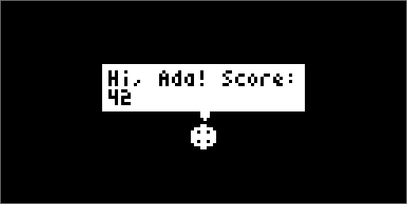
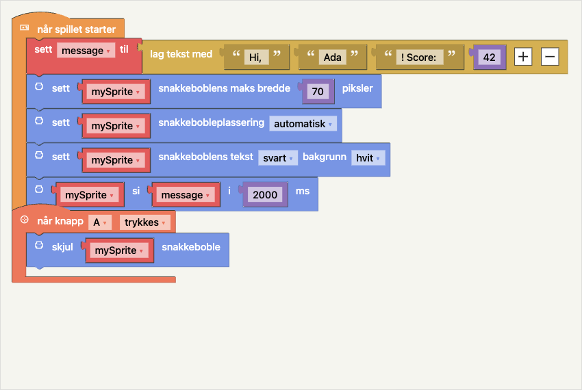

# Snakkebobler og sammensatt tekst

Bruk snakkebobler til korte replikker, hint og tilbakemeldinger fra en sprite.
Spillet fortsetter mens boblen vises. Boblen følger spriten og kameraet,
bryter teksten i linjer og holder seg innenfor skjermen på 128 × 64 piksler.
Boblen har skarpe hjørner og en liten peker mot spriten.



## Vis og skjul en melding

Under **Sprites** finnes disse blokkene:

| Blokk | Innganger og innstillinger | Virkning |
| --- | --- | --- |
| `mySprite si tekst` | Sprite og tekst | Viser teksten til den erstattes eller skjules. |
| `mySprite si tekst i ms` | Sprite, tekst og varighet i millisekunder | Skjuler boblen automatisk etter varigheten. 2000 ms er to sekunder. |
| `sett mySprite snakkebobleplassering` | Sprite og automatisk/over/under | Velger hvilken side av spriten boblen skal vises på. |
| `sett mySprite snakkeboblens maks bredde piksler` | Sprite og tall | Velger maksimal ytre bredde, fra 14 til 128 piksler. Standard er 86. |
| `sett mySprite snakkeboblens tekst … bakgrunn …` | Sprite og svart/hvit for hver farge | Velger tekst- og bakgrunnsfarge. Standard er svart tekst på hvit bakgrunn. |
| `skjul mySprite snakkeboble` | Sprite | Fjerner meldingen, men beholder innstillingene. |

Blokkene utfører handlinger; de gir ingen utgangsverdi. Tekstinngangen tar
skrevet tekst, en tekstvariabel, et tall eller resultatet av **lag tekst med**.
Varighet og bredde tar også variabler og beregninger.

En ny `si`-kommando erstatter spritens forrige melding og starter varigheten
på nytt. Null millisekunder betyr at meldingen blir stående. Tom tekst eller
negativ varighet skjuler boblen. Å slette spriten fjerner også boblen.
En usynlig sprite viser ingen boble; varigheten fortsetter å løpe.

Plassering, bredde og farger gjelder én sprite, også når boblen allerede er
synlig. **Automatisk** foretrekker over spriten og bruker under ved toppen
av skjermen. **Over** og **under** flyttes til motsatt side når det er nødvendig
og plass der. Boblen flyttes ellers slik at hele boksen holder seg på skjermen.
Bruk ulike tekst- og bakgrunnsfarger for å kunne lese teksten.

## Sett sammen flere deler

Under **Grafikk** finnes **lag tekst med**. Den gir én tekst som utgang.
Hvert felt kan inneholde tekst, en variabel, et tall eller sann/usann.
Tall blir automatisk tekst, og sann/usann blir `true`/`false`.

- Trykk **+** i blokken for å legge til ett felt. To felt kan bli tre, fire eller flere.
- Trykk **−** for å fjerne siste felt. Når du redigerer, beholdes minst to felt.
- En vanlig blokk i et fjernet felt blir liggende på arbeidsflaten, så den kan brukes igjen.
- Knappene fungerer med mus, touch og Enter/mellomrom når de har tastaturfokus.
- Antall felt lagres med prosjektet. Eldre prosjekter med standardblokken kan fortsatt åpnes.

Mellomrom legges ikke til automatisk. Skriv dem i tekstfeltene, for eksempel
`"Hi, " + spillernavn + "! Score: " + poeng`. For å bruke **fire felt**,
trykk + to ganger og koble inn delene i denne rekkefølgen.



## Eksempel med variabler

1. Opprett en sprite og lagre den i `mySprite`.
2. Sett tekstvariabelen `spillernavn` til `Ada`, og tallvariabelen `poeng` til `42`.
3. Sett `message` til **lag tekst med** med de fire delene over.
4. Sett snakkeboblens maks bredde til `70` og plasseringen til **automatisk**.
5. Bruk `mySprite si message i 2000 ms`.

Boblen viser `Hi, Ada! Score: 42` med automatisk linjebryting.
Teksten kopieres når `si` kjøres. Hvis poeng eller message endres senere,
må `si` kjøres igjen for å oppdatere boblen. Du kan for eksempel kjøre den
når spilleren trykker A eller plukker opp en mynt.

## Font, lange meldinger og grenser

Fonten er en egen kompakt ASCII-font på **3 × 5 piksler**. Hvert tegn bruker
4 piksler i bredden inkludert mellomrom, og linjene har 6 pikslers høyde.
Den inneholder store og små engelske bokstaver, tall, mellomrom og vanlige
ASCII-symboler. Æøå, aksenttegn og emoji støttes ikke og vises som `?`.
Vanlig skjermtekst beholder den eksisterende 5 × 7-fonten.

Teksten brytes ved mellomrom. Lange ord deles når de ikke får plass på en
linje. Et linjeskift i teksten starter en ny linje. Boblen viser opptil tre
linjer om gangen. Hvis teksten trenger flere linjer, byttes side automatisk
hvert **1500 ms**, og sidene går i sirkel til meldingen skjules.
Velg tilstrekkelig varighet til å lese alle sidene, eller bruk varig visning.

| Enhet | Tegn per melding/tekstvariabel i spill med snakkebobler | Samtidige bobler |
| --- | --- | --- |
| Vanlig ArduCade-enhet | 63 | 2 |
| ATtiny85 | 21 | 1 |

Tekst som overskrider grensen, avkortes. Hvis en tredje sprite viser en
melding, erstatter den den eldste boblen; på ATtiny85 erstatter en annen
sprite den ene boblen. Innstillingene til spritene beholdes.
I spill uten snakkebobler er tekstvariabler begrenset til 31 tegn
(21 på ATtiny85). Hver tekstvariabel bruker en fast tekstbuffer på enheten.

## JavaScript og Python

De samme funksjonene er tilgjengelige i teksteditoren. Eksemplene forutsetter
at `mySprite` allerede er opprettet.

```javascript
let message;
function greet() {
    message = text("Hi, ", "Ada", "! Score: ", 42);
    sprite.setSpeechWidth(mySprite, 70);
    sprite.setSpeechPosition(mySprite, 0); // 0 automatisk, 1 over, 2 under
    sprite.setSpeechColors(mySprite, 0, 1); // 0 svart, 1 hvit
    sprite.say(mySprite, message, 2000); // 0 ms for varig visning
}
```

```python
def greet():
    global message
    message = text("Hi, ", "Ada", "! Score: ", 42)
    sprite.set_speech_width(mySprite, 70)
    sprite.set_speech_position(mySprite, 0)
    sprite.set_speech_colors(mySprite, 0, 1)
    sprite.say(mySprite, message, 2000)
```

Bruk `sprite.hideSpeech(mySprite)` / `sprite.hide_speech(mySprite)` for å
skjule meldingen. Enhetskoden inkluderer bare snakkeboblefonten og
boblelagringen når spillet bruker snakkebobleblokkene eller disse funksjonene.

På små enheter avhenger det ledige minnet også av resten av spillet.
Generatoren utelater lagring for plassering, bredde og farger når disse
innstillingene ikke brukes, og utelater bevegelseskode i snakkeboblespill
uten hastighet, akselerasjon eller egen C++-kode.
