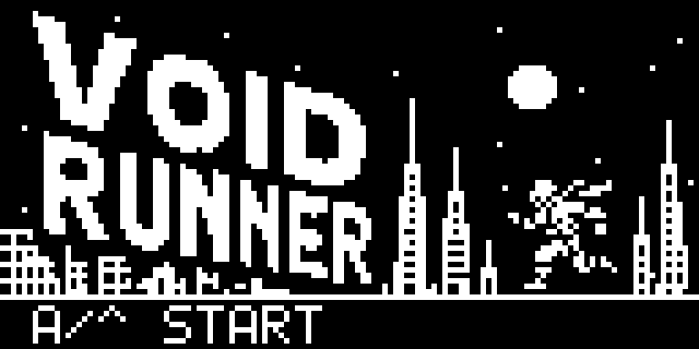

# Void Runner

Åpne **Void Runner** i malgalleriet for å lage et løpespill med hopp, skli,
parallax-bakgrunner og tre lagrede rekordtider. Startskjermen har en egen
svart/hvitt-illustrasjon i skjermens opprinnelige oppløsning, 128 × 64 piksler.
Malgalleriet bruker denne startskjermen som forhåndsvisning.

Trykk **A** eller **Opp** for å starte. Bruk de samme knappene for å hoppe
over lave hinder, og **B** eller **Ned** for å skli under droner og lasere.
I simulatoren kan du også trykke på skjermknappene på et nettbrett.

Resultatet er tiden du overlever. De tre lengste tidene lagres som rekorder;
spillet har ingen egen poengsum for passerte hinder.
Under løpet viser toppfeltet kun tiden. Farten øker gradvis som før.

Du kan endre illustrasjonen i **Bilder** ved å velge `titleScreen`.
Prøv for eksempel å tegne en annen bysilhuett eller endre logoen.
La de nederste ni pikselradene være svarte: startteksten tegnes av spillets
tegneblokker, slik at den kan følge valgt språk. Bildet vises med
**Tegn bilde** ved X = 0 og Y = 0 når `state` er 0.

Den nye illustrasjonen følger med når du oppretter et nytt prosjekt fra
malen. Et allerede lagret prosjekt beholder sitt eget `titleScreen`-bilde.

## Musikk og lydeffekter

Spillet har polyfonisk lyd: fire stemmer med melodi, harmoni, bass og trommer.
Startskjermen spiller **Cave**, og under løpet spiller **Void Drive**, et
12 sekunders lydspor i e-moll med tempo 160 som gjentas. Rekordskjermen
spiller **Menu** når løpet er slutt.

| Hendelse | Polyfonisk effekt |
| --- | --- |
| Hopp med A/Opp | Jump: en stigende tone med bassanslag |
| Dukk/skli med B/Ned | Laser: en fallende sveipelyd |

Hopp og dukk lager lyd når handlingen begynner. Å holde knappen inne spiller
ikke effekten på nytt hver bilderamme. Dette er spillets eneste lydeffekter:
start, passerte hinder, kollisjon og nye rekorder utløser ingen effekt.

Polyfoniske effekter og musikk deler én firestemmers avspiller. En effekt
avbryter derfor musikken kort; musikken fortsetter automatisk fra samme sted
når effekten er ferdig. Den starter ikke på nytt etter hopp eller dukk.
Spillet fortsetter mens lydene spiller.

Åpne **Musikkstudio**, velg sangen **Void Drive**, og endre de fire stemmene
for å lage din egen bakgrunnsmusikk. Prøv for eksempel å senke tempoet fra
160 til 140. Under **Musikk** i blokkene kan du bytte effekt eller sang.
Timer 0 måler løpet og har visningsformat **skjult**, slik at den ikke tegnes
over spillets egen tid og rekordliste. Det trengs ingen ekstra lydtimer.

Simulatoren og Arduboy spiller alle fire stemmene. Enheter uten støtte for
fire stemmer bruker prosjektets vanlige én-stemmes avspilling. Se
[lyddokumentasjonen](songs.md) for maskinvarestøtte.

Opprett et nytt prosjekt fra Void Runner-malen for å få musikken og blokkene.
Allerede lagrede prosjekter beholder sine egne lydblokker.
